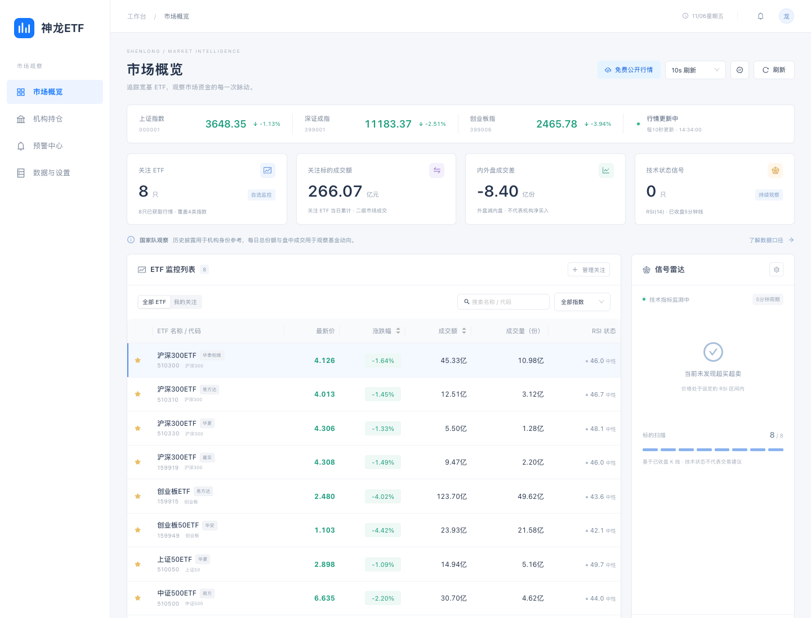
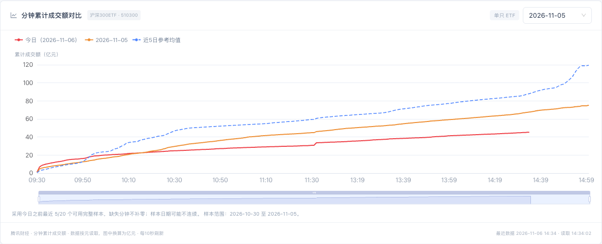

<div align="center">

# 神龙ETF

**面向中国宽基 ETF 的本地市场观察看板**

看行情、比较成交、追踪基金份额，让每一个信号都有数据依据。


[](LICENSE)

[快速开始](#快速开始) · [功能](#功能) · [数据与边界](#数据与边界) · [参与贡献](#参与贡献)

</div>

神龙ETF 是一个使用 **React、Ant Design、ECharts 和 Express** 构建的中国市场 ETF 观察工具。它将公开行情、分钟累计成交额、交易所日度份额和历史机构披露放在同一个界面中，支持自选与技术指标提醒。

当前版本无需配置 API Key，适合在本机或可信局域网内运行。所有行情均来自真实公开数据源，获取失败时显示明确状态。

> **使用前请了解：** 本项目不能识别国家队的实时买卖。ETF 总份额变化、内外盘成交差和历史机构持仓是不同口径的数据，请勿混用。

## 预览

### 市场概览

主要指数、ETF 自选列表、成交量额与 RSI 状态集中展示，支持搜索、分类与可选刷新间隔。



### 分钟累计成交额对比

选中 ETF 后，可将今日分钟累计成交额与指定历史日期、同分钟历史均值进行对比。




*以上均为实际界面截图，行情、报告期和均值样本数仅代表截图时状态，以运行时实际数据为准。*

## 功能

- **市场概览**：宽基 ETF 与主要指数快照，价格、涨跌幅、成交量额一屏查看。
- **行情详情**：分时、成交均价、5分钟 K 线、前复权日 K、布林带和五档盘口。
- **成交对比**：今日与指定历史日的分钟累计成交额对比，支持悬浮提示、图例开关和缩放。
- **资金对比**：对照8只ETF的最新价、规模、成交额、同时点倍数、主动净买入估算、日度份额与近30日成交额，支持搜索、筛选和排序，并标记汇金历史可见记录。
- **日度份额**：直接读取沪深交易所的 ETF 总份额、统计日期及较上一统计日变化。
- **历史持仓**：展示公开前十大持有人历史名单、报告期及可比份额变化，明确标注历史快照。
- **技术提醒**：基于已收盘5分钟线的 RSI(14) 超买超卖观察，支持自定义阈值、已读管理及浏览器通知。
- **自选与刷新**：搜索、分类、排序、自选关注；可选 **1 / 3 / 5 / 10 / 15 / 30 秒**刷新，支持暂停并保存偏好。
- **轻量界面**：Ant Design 扁平风格，适配桌面与手机，遵循 A 股红涨绿跌习惯。

### 默认监控范围

| 类型 | ETF 代码 | 管理人 |
| --- | --- | --- |
| 沪深300 | `510300`、`510310`、`510330`、`159919` | 华泰柏瑞、易方达、华夏、嘉实 |
| 创业板 | `159915` | 易方达 |
| 创业板50 | `159949` | 华安 |
| 上证50 | `510050` | 华夏 |
| 中证500 | `510500` | 南方 |

同时展示上证指数、深证成指与创业板指。当前支持以上8只 ETF，尚不支持在界面中添加任意证券代码；标的定义见 [`shared/catalog.ts`](shared/catalog.ts)。

## 快速开始

### 环境要求

- Node.js **22.12 或更新版本**，建议使用 Node.js 24。
- npm，以及能够访问公开行情和交易所网站的网络环境。

### 本地开发

```bash
git clone https://github.com/loong0306/shenlong-etf.git
cd shenlong-etf
npm ci
npm run dev
```

打开 **[http://localhost:5173](http://localhost:5173)**。

开发页面监听 `0.0.0.0:5173`，API 监听 `127.0.0.1:3001`，浏览器通过同源代理访问 API。macOS 用户也可双击根目录的 `启动神龙ETF.command`；需要提前安装 Node.js。

### 构建并运行

```bash
npm run build
npm start
```

打开 **[http://localhost:3001](http://localhost:3001)**。生产服务同时提供页面与 API，默认监听全部网卡。

<details>
<summary>Windows PowerShell 启动生产服务</summary>

`npm start` 中的环境变量写法适用于 macOS / Linux。在 PowerShell 中可改用：

```powershell
npm run build
$env:NODE_ENV = "production"
node --import tsx server/index.ts
```

</details>


## 数据与边界

### 数据来源

| 内容 | 来源 | 更新方式 |
| --- | --- | --- |
| 行情快照、内外盘、五档盘口 | 腾讯财经公开接口 | 按所选刷新间隔请求，默认10秒 |
| 分时、分钟线、日 K | 腾讯财经公开接口 | 每60秒刷新，后端有缓存 |
| 分钟累计成交额 | 腾讯财经公开接口 | 按所选刷新间隔请求，并在本地积累历史 |
| 资金对比的成交基准与历史柱图 | 新浪财经公开5分钟线 | 汇总完整交易日的真实成交额，缓存10分钟 |
| ETF 日度总份额 | 沪深交易所公开接口 | 清算后 / T+1 数据，以实际统计日期为准 |
| 历史前十大持有人 | 新浪财经转载披露页面 | 定期读取，显示来源报告期 |

公开接口可能延迟、限流、暂停或调整格式，本项目不承诺交易级实时性和服务可用性。提高请求频率不等于源数据更新更快；使用时请遵守数据提供方的条款与频率限制。源码的使用授权也不代表获得第三方数据的再分发授权。

来源入口：[腾讯财经](https://gu.qq.com/sh510300) · [上交所 ETF 规模](https://www.sse.com.cn/market/funddata/volumn/etfvolumn/) · [深交所基金列表](https://fund.szse.cn/marketdata/fundslist/index.html) · [新浪持有人页面](https://stock.finance.sina.com.cn/fundInfo/view/FundInfo_JJCYR.php?symbol=510300)。

### 不同指标说明什么

| 指标 | 能观察什么 | 不能据此认定什么 |
| --- | --- | --- |
| 成交量 / 成交额 | 二级市场交易活跃度 | 单独的净买入或净卖出 |
| 内外盘成交差 | 数据源分类下的成交方向参考 | 国家队或特定机构买卖 |
| ETF 总份额变化 | 全体持有人的合计份额变化 | 某家机构的持仓变化 |
| 历史持有人名单 | 对应报告期末的公开持仓 | 当前或 T+1 的机构账户持仓 |

份额变化可能受到申赎、拆分等事件影响。观察机构按明确全名匹配，仅覆盖公开名单中可识别的主体；未出现在前十不代表未持有。

2026年5月1日起实施的定期报告准则第31条未再将前十大持有人名单列为强制披露项目，因此不能保证持续获取同口径的后续名单。历史披露请回到基金管理人的正式报告核验。[查看准则原文](https://www.sse.com.cn/lawandrules/regulations/csrcannoun/c/10814374/files/31e45535438641ea84592689b7e71f50.pdf)

### 累计成交额的历史均值

免费分时接口目前实测仅返回最近5个交易日，初次使用通常只有4个历史完整样本。界面会显示实际样本数，不将少量样本冒充“近20日均值”。

- 排除今日，最多采用最近20个有15:00记录的可用历史样本。
- 展示基准日期范围；样本可能不连续，因此满20个样本时标注为“最近20个可用日均值”。
- 某分钟在任一基准日缺失，则该均值点留空，不补零；没有今日数据时，今日曲线留空。
- 累计成交额直接按源数据的元换算为亿元，不再次累加；午休和15:00后的记录不纳入图表。

### 资金对比的计算口径

- **同时点倍数** = 当前成交额 ÷（历史日均成交额 × 同时刻历史平均完成比例）。排除行情日，最多使用20个可用完整交易日；完整日须含48个5分钟时点，时点之间线性插值，午休期间保持不变。样本数量和日期范围可在界面查看。
- **主动净买入估算** =（外盘 − 内盘）÷（外盘 + 内盘）× 成交额，仅表示成交方向估算，不代表净流入、基金申赎或特定机构买卖。
- **规模**使用行情现价 × 行情总份额，非净值口径；**日度份额**另取交易所数据，并显示实际统计日期。
- **近30日成交额**最多展示29个完整历史日和当前行情日；**汇金历史持有**仅汇总2025年报可见名单中的中央汇金投资与中央汇金资管，无可见记录时留空。

展示方式参考[ETF成交额监控](https://etf-turnover-tracker.app.workbuddy.host/?sharecode=2V35TELSL4#notes)，历史日总额采用真实5分钟成交额汇总，与参考站的日均金额估算法有所区别。此页基准独立于上方腾讯分时图的本地积累样本。

### 技术提醒

RSI 使用14周期 Wilder 平滑，默认低于30提示超卖、高于70提示超买；布林带使用20周期与2倍总体标准差，均基于已收盘 K 线。

行情详情支持**买卖观察点**开关：

- **开仓观察（▲）**：已收盘5分钟K线的RSI从低于超卖阈值回到阈值及以上，且收盘价高于上一根。
- **减仓观察（▼）**：RSI从高于超买阈值回到阈值及以下，且收盘价低于上一根。持续超买或超卖不会重复产生观察点。
- **同一时间只跟踪一个仓位状态**：开仓后必须出现减仓点，才会产生下一次开仓；反之间隔同理。窗口内第一个穿越点无论方向都会保留（不因缺少前置信号被丢弃），之后严格交替。
- 分时图显示当日对应时点，5分钟K线显示可用历史点；日K不混入5分钟信号。悬浮或点按标记查看时间、收盘参考价、RSI变化及原因，图下显示最近确认点；过期点明确标为历史观察。
- 点位在K线收盘后确认，参考价不是保证可成交价格。规则只使用当时及以前的数据，未进行收益回测，不提供预测概率或收益承诺。图上观察点不写入现有超买超卖预警记录，也不新增系统通知。

**完整分时时间轴**固定为09:30—11:30、13:00—15:00，压缩午休。未来时段及缺失时点的成交价、均价、成交量留空，不补零或向未来延长曲线。

仅监测自选 ETF。行情超过120秒、指标 K 线超过7分钟或样本不足时，不产生实时提醒。同一标的同类信号冷却10分钟，同一根 K 线不重复记录。

**提醒依赖页面持续运行。** 关闭页面后不再提醒，浏览器休眠或节流也可能造成延迟。行情和累计成交额采用所选间隔，K线及技术指标保持60秒刷新周期。

## 本地存储

| 位置 | 内容 |
| --- | --- |
| 浏览器 `localStorage` | 自选、刷新偏好、预警规则和记录；预警最多200条 |
| `data/turnover/` | 按 ETF 保存的真实历史分时，用于逐步积累均值样本 |
| 服务内存 | 数据请求缓存，重启后清空 |

只有访问过图表的 ETF 才会积累历史；关闭页面后不会后台采集。长时间未访问可能遗漏接口回溯窗口外的交易日。

`data/`、`artifacts/`、`node_modules/`、`dist/` 和 `.env` 已加入忽略规则，发布仓库时不应提交本地运行数据或凭据。

## 开发与验证

```bash
npm test                  # 金融计算、源数据解析、预警判定与设置校验
npm run check             # TypeScript 类型检查
npm run build             # 类型检查与生产构建
npm run test:browser       # 真实数据的桌面、移动端交互检查
npm run test:regression    # 使用受控接口样本验证预警与刷新行为
node scripts/turnover-check.mjs  # 累计成交额图表与 ETF 联动检查
node scripts/comparison-check.mjs # 资金对比的真实数据与移动端检查
```

浏览器检查需先启动开发服务，并安装可用的 Chrome。脚本默认查找 macOS 的 Google Chrome；其他环境需设置 `BROWSER_EXECUTABLE_PATH`。真实数据检查依赖外部接口可用性，截图输出到 `artifacts/`。

### 目录结构

```text
src/                  页面、图表与浏览器端状态
shared/               数据类型、标的与金融计算
server/               数据源适配、缓存与 HTTP API
scripts/              浏览器验证脚本
tests/                自动化测试及受控数据样本
docs/images/          README 预览图片
```

## 参与贡献

欢迎通过 Issues 提交问题、讨论需求，或通过 Pull Request 改进项目。

- **报告问题**：提供操作步骤、预期与实际结果、Node.js / 浏览器版本。数据问题请附 ETF 代码、统计日期、来源和错误信息，避免上传凭据或完整私人环境配置。
- **提交改动**：保持范围集中，在 PR 中说明改动目的和验证方式。涉及数据解析、单位或指标算法时，请添加可复现的测试样本。
- **提交前检查**：运行 `npm test` 和 `npm run build`；界面改动请补充桌面或手机截图。
- **数据相关贡献**：优先使用可核验的公开来源，保留原始时间与单位。不要将推测性资金动向标记为已确认机构交易。


## 许可证

本项目采用 [MIT License](LICENSE)。第三方数据的使用与再分发仍须遵守其提供方的条款。

## 免责声明

本项目用于公开市场数据观察、学习与研究，不提供投资建议，不包含交易下单功能。数据与指标可能存在延迟或误差，投资决策请结合正式披露和其他可靠来源独立判断。
